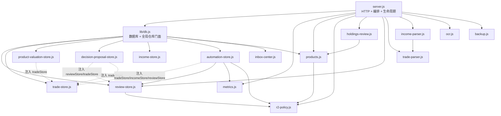

# 钱多多后端依赖图

> 历史快照：本文记录当时的重构、审计或验收结果，不代表当前实现或运行状态。当前事实以代码、`TODO.md`、运行接口和 [文档地图](../../README.md) 为准。

## 1. 模块依赖概览

当前没有发现 CommonJS `require()` 层面的循环依赖，但存在明显的运行时对象依赖和“读取即写入”的隐式副作用。



实线表示模块级 `require()`；虚线表示工厂参数/对象注入。

## 2. 各模块当前职责

| 模块 | 当前职责 | 主要副作用 |
| --- | --- | --- |
| `server.js` | HTTP 路由、参数校验、同源检查、图片解码、OCR 编排、dashboard 聚合、导出、静态文件、启动/定时/关闭 | 调用几乎所有 store；写 HTTP 响应；启动定时器 |
| `lib/db.js` | 打开 SQLite、建表/迁移、组装 store、账本/本金 CRUD、旧持仓兼容门面、收益截图跨表编排 | 启动时改 schema；创建/备份目录；交易与收益数据写入 |
| `trade-store.js` | 交易命令、去重、批次匹配、持仓、收件箱、审计 | 交易/收件箱/批次/审计写库；截图文件写删 |
| `review-store.js` | 决策、旧持仓表、持仓复核设置、产品事件、月/季复盘笔记、复盘 workspace | 决策/设置/事件/笔记写库；启动时迁移列/表 |
| `income-store.js` | 收益截图文件和收件箱表 | 截图文件写删；收件箱更新 |
| `income-parser.js` | OCR 文本到账户/产品收益的解析 | 纯计算 |
| `product-valuation-store.js` | 逐产品收益、收益延迟规则、对账、修正审计 | 产品收益和设置写库；直接查询交易与账户收益 |
| `automation-store.js` | 自动评估、任务、通知、复盘草稿、自动周期 | 评估/任务/通知/草稿写库；直接查询账本、本金和复盘中转 |
| `decision-proposal-store.js` | 提案生成、采纳/拒绝、过期、交易匹配、执行偏差 | 提案、决策、交易关联写库 |
| `inbox-center.js` | 聚合交易、收益、对账、评估、复盘等消息状态 | 消息中心写库 |
| `products.js` | 产品 CSV、候选、分配和观察池 | 读文件；纯计算为主 |
| `holdings-review.js` | 持仓替换/观察分析 | 纯计算 |
| `metrics.js` | 账本统计、窗口、月度评级、日期 | 纯计算 |
| `r2-policy.js` | 固定策略常量和期限桶校验 | 纯计算 |
| `trade-parser.js` | 成交 OCR 文本解析 | 纯计算 |
| `ocr.js` | PowerShell OCR 子进程 | 启动外部进程；读取本地图片 |
| `backup.js` | `VACUUM INTO` 备份、列出/清理 | 创建/删除备份文件 |

## 3. 主要调用链

### 3.1 Dashboard 读取链

```text
GET /api/dashboard
  -> server.dashboardPayload(repository)
     -> repository.listRecords()
     -> metrics.enrichRecords/buildReview/buildWindows/summarize
     -> repository.tradeStore.getOverview()
        -> tradeStore.getPortfolio()
           -> tradeStore.rebuildAllocations()              [写交易/批次表]
     -> repository.getCapitalState()
     -> repository.getAllocationSettings()
     -> repository.listDecisions()
     -> products.buildProductView()
     -> holdingsReview.buildHoldingReviews()
     -> repository.getReviewWorkspace()
     -> repository.productValuationStore.getWorkspace()
     -> repository.automationStore.getWorkspace()
     -> repository.decisionProposalStore.sync(payload)    [写提案/决策]
     -> repository.inboxCenter.sync(payload)              [写消息中心]
```

这是一个带业务副作用的聚合查询。阶段 2 迁移时需要把 HTTP 层与“刷新派生状态”的动作显式命名为 command/refresh，而不是隐藏在一个 getter 中。

### 3.2 创建/确认交易

```text
POST /api/trades
  -> validateTradePayload()
  -> 检查 decision_id
  -> tradeStore.createTrade()
     -> BEGIN IMMEDIATE
     -> insert trade
     -> rebuildAllocations()
     -> insert trade audit
     -> COMMIT
  -> server.syncTradeDecisionAndEvaluate()
     -> decisionProposalStore.matchTrade()
        -> tradeStore.updateTrade()
        -> decision update
     -> decisionProposalStore.reconcileExecutionStatuses()
     -> automationStore.ensureTradeDecisions()
        -> reviewStore.createDecision()
        -> tradeStore.updateTrade()
     -> automationStore.runCycle()
     -> decisionProposalStore.reconcileExecutionStatuses()
  -> dashboardPayload()
```

交易命令本身原子，但“补齐决策、匹配提案、运行评估和刷新 dashboard”在交易事务之外，整体不是原子工作流。

### 3.3 交易截图

```text
POST /api/trades/inbox
  -> decodeImagePayload()
  -> tradeStore.saveInboxImage()       [文件先落盘]
  -> ocrImage()                        [异步外部进程]
  -> parseTradeText()
  -> tradeStore.addInbox()             [唯一 SHA-256 记录]
  -> tradeStore.getOverview()
```

```text
POST /api/trades/inbox/:id/apply
  -> merge parsed + body
  -> validateTradePayload()
  -> tradeStore.applyInbox()
     -> 找到已有交易:
        -> 可能 confirmTrade() / updateTrade() / updateInbox()
     -> 未找到:
        -> createTrade() [事务]
        -> updateInbox() [另一个写]
  -> syncTradeDecisionAndEvaluate()
```

### 3.4 收益截图

```text
POST /api/income/inbox
  -> incomeStore.saveInboxImage()      [文件先落盘]
  -> ocrImage()
  -> incomeStore.lookup/getPortfolio
  -> parseIncomeText()
  -> incomeStore.addInbox()
  -> 若 OCR/置信度通过:
     repository.applyIncomeScreenshot()
       -> productValuationStore.upsertMany()  [事务 A]
       -> insertRecord.run()                  [写 B]
       -> incomeStore.updateInbox()           [写 C]
  -> dashboardPayload()
```

`lib/db.js` 的 `applyIncomeScreenshot()` 是当前最重要的跨域编排点。

### 3.5 决策提案

```text
GET /api/dashboard 或 GET /api/decision-proposals
  -> dashboardPayload()
  -> decisionProposalStore.sync()
     -> expirePending()
     -> holdingSwitchProposal()
     -> cashAllocationProposal()
     -> upsertProposal()
     -> reconcileExecutionStatuses()
```

```text
POST /api/decision-proposals/:id/adopt
  -> reviewStore.createDecision()
  -> proposal updateStatus('accepted')
  -> dashboardPayload()
```

### 3.6 自动评估

```text
POST /api/automation/run / 启动定时器 / 交易后
  -> automationStore.runCycle()
     -> seedLegacyDecisionStrategy()
     -> migrateDailyOpenPolicy()
     -> linkLegacyDecision()
     -> ensureTradeDecisions()
     -> getContext()
        -> tradeStore.getOverview()
        -> buildHoldingsSummary()
        -> 读 daily_records / capital_settings
        -> reviewStore.listDecisions/listProductEvents
     -> scanInbox()
     -> scanMaturity()
     -> scanEvaluations()
        -> evaluate decision/trade
        -> recordEvaluation()
        -> applyDecisionRun() / enqueueJob() / saveNotification()
     -> scanDrafts()
     -> resolveStaleNotifications()
```

`runCycle()` 是一个大型纵向流程，当前没有事务包裹整轮，也没有持久化租约。

### 3.7 备份与恢复

```text
服务启动 / POST /api/backups
  -> backup.createDailyBackup()
     -> SQLite VACUUM INTO data/backups/r2_ledger-YYYY-MM-DD.sqlite
  -> backup.pruneBackups(45)

npm run db:restore
  -> 检查 /api/health
  -> copyFileSync(current db, pre-restore-*.sqlite)
  -> copyFileSync(backup, current db)
  -> 删除当前 -wal / -shm
```

## 4. 跨模块直接数据访问

当前并非“一个模块只访问自己的表”：

| 模块 | 越域读取/写入 |
| --- | --- |
| `product-valuation-store.js` | 直接查询 `trade_transactions` 以获得持仓起止日；直接 JOIN `daily_records` 做账户对账 |
| `automation-store.js` | 直接查询 `daily_records`、`capital_settings`、`app_meta`；写 review decisions/trades/proposals 相关状态 |
| `decision-proposal-store.js` | 通过注入对象写 `decision_log` 和 `trade_transactions` |
| `inbox-center.js` | 根据多个域对象聚合，却写自己的 `inbox_items` |
| `db.js` | 同时拥有账本、本金、产品、收益截图工作流和多个域的门面 |
| `server.js` | 直接组合所有 store，并调用 domain 计算 |

迁移目标不是立刻禁掉这些读取，而是给每个读取建立明确的只读接口/查询对象，避免模块直接依赖别家 SQL。

## 5. 全局状态与生命周期风险

### 5.1 模块加载时状态

- `server.js` 在模块加载时计算 `ROOT`、`DIST_DIR`、`PUBLIC_DIR`、`STATIC_DIR`、`DEFAULT_PRODUCT_CSV`。
- 如果测试先启动、后改 `dist/index.html` 或工作目录，模块缓存可能导致测试看到的路径与预期不同。
- `process.env` 在 `resolveProductCsv()`、`startServer()` 和 OCR 中读取。

### 5.2 每个 repository 的内存状态

- `automationStore` 内有 `running` 布尔变量，只保护同一 repository 实例的并发 cycle。
- `startServer()` 内有 `automationTimer` 和 `lastAutomationCycle`。
- 多个 store 各自缓存 prepared statement；数据库关闭后不能继续调用。

### 5.3 进程级状态

- `startServer()` 每次调用都会向 `process` 注册 `SIGINT`/`SIGTERM`，没有返回注销函数。
- `scripts/dev.js` 也有 `process.on('exit')` 和信号处理。
- `daemon.ps1` 负责重启；`prod:stop` 直接 `Stop-Process -Force`，不会触发 Node 优雅关闭。

### 5.4 定时任务入口

只有 `startServer()` 注册定时器：

- 启动后 250 ms 执行一次 `startup`。
- 每 60 秒检查一次，实际间隔由 `scheduler_minutes` 控制。
- 定时器调用 `automationStore.runCycle()`，失败只记录 warning 并写 `automation_runs.failed`。

`createServer()` 本身不创建定时器，测试可以安全用 `createServer` 做 HTTP 测试。

## 6. 建议的模块所有权

目标模块不应按现有大 store 原样搬运，而应明确：

| 目标模块 | 拥有数据/命令 | 建议只读依赖 |
| --- | --- | --- |
| `ledger` | `daily_records`、账本查询/导出 | capital、产品收益汇总 |
| `capital` | `capital_settings`、`capital_events`、本金快照重算 | 无 |
| `products` | `products`、产品 CSV、分配设置 | metrics 或纯日期/金额工具 |
| `trades` | `trade_transactions`、`trade_allocations`、`trade_audit`、`trade_inbox` | decisions、filesystem、OCR |
| `income` | `income_inbox`、产品收益入账编排 | product valuations、ledger、trades |
| `product-valuations` | `product_daily_valuations`、设置、审计、对账 | ledger、trades 的只读查询 |
| `decisions` | `decision_log`、提案 | trades 的只读查询 |
| `evaluations` | `evaluation_runs`、评估规则、评估任务 | decisions、trades、ledger |
| `review` | 复盘笔记、草稿、周期复盘 | ledger、trades、decisions |
| `notifications` | `notifications`、`inbox_items`、消息聚合 | 各域只读快照 |
| `operations` | 备份、恢复边界、调度注册、健康检查 | database、filesystem、logger |

共享层只放：

- 日期解析与上海日期。
- 金额舍入规则。
- 业务错误类型。
- 通用校验。
- 事务接口。
- 文件原子写入接口。

不应建立：

- 全局万能 `utils.js`。
- 全局万能 repository。
- 通用规则 DSL 或复杂依赖注入容器。

## 7. 依赖迁移原则

1. 先用测试固定当前行为，再调整调用方向。
2. repository 只依赖数据库连接和本域表；跨域读取通过显式 query port 或只读快照。
3. 一个业务用例只能拥有一个事务协调者。
4. 读取接口默认不写库；需要刷新的派生状态改由明确的后台任务或命令执行。
5. 外部子进程、文件写入和数据库事务之间使用可恢复状态机或补偿记录。
6. 任何跨域同步失败必须留下可诊断状态，不依赖内存布尔变量。
